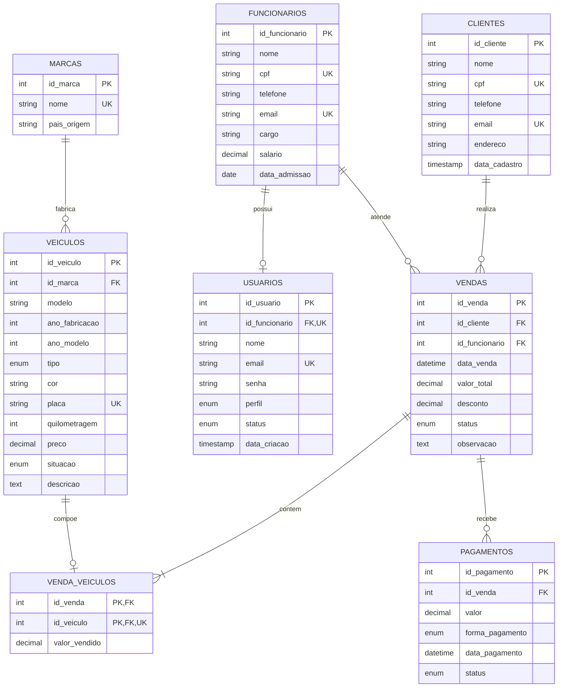

# DOCUMENTAÇÃO ACADÊMICA — PROJETO A3
# SISTEMA MAGNATA AUTOMÓVEIS — GESTÃO DE CONCESSIONÁRIA PREMIUM

**Curso:** Graduação em Análise e Desenvolvimento de Sistemas (ADS)  
**Semestre:** 3º Semestre  
**Unidade Curricular:** Projeto A3 — Desenvolvimento de Aplicações Web e Banco de Dados  
**Ano/Semestre:** 2026/2  

---

## 1. INTRODUÇÃO

O mercado automotivo contemporâneo exige alto dinamismo operacional, controle rigoroso de estoque e rastreabilidade total de operações comerciais e financeiras. Em concessionárias multimarcas — que comercializam simultaneamente veículos novos (0 km) e seminovos/usados —, a carência de automação gera gargalos críticos, tais como vendas duplicadas do mesmo veículo, divergência de saldo a receber e falta de visibilidade sobre o faturamento real.

O projeto **Magnata Automóveis** foi concebido como uma solução web robusta, modular e didática, apresentando identidade visual exclusiva em preto ônix e dourado metálico, construída em conformidade com as diretrizes do terceiro semestre do curso de Análise e Desenvolvimento de Sistemas. O software centraliza as rotinas operacionais da concessionária, integrando clientes, funcionários, montadoras, catálogo de estoque, vendas e controle de recebimentos parciais e integrais em uma única plataforma profissional.

---

## 2. OBJETIVO GERAL

Desenvolver um sistema web completo, responsivo e seguro denominado **Magnata Automóveis**, aplicando os paradigmas do PHP estruturado modular, conexão a banco de dados relacional via PDO com MySQL e front-end com Bootstrap 5 e paleta refinada em preto e dourado, capaz de gerenciar todas as etapas operacionais e comerciais de uma concessionária de veículos multimarcas.

---

## 3. OBJETIVOS ESPECÍFICOS

1. **Modelar e estruturar** um banco de dados relacional normalizado (3FN) composto por 8 tabelas com chaves primárias, chaves estrangeiras, restrições de unicidade (`UNIQUE`), checagem (`CHECK`) e índices de busca.
2. **Implementar autenticação e controle de acesso** seguro baseado em sessões PHP (`session_start`, `session_regenerate_id`, hashing de senhas com `password_hash`/`password_verify` e proteção contra CSRF e SQL Injection).
3. **Construir CRUDs operacionais** completos para clientes, funcionários, marcas e veículos, com validações em servidor e proteções de integridade referencial histórica.
4. **Garantir atomicidade comercial** por meio de **Transações PDO** (`beginTransaction`, `commit`, `rollBack`) no processo de venda, assegurando que o veículo seja reservado ou vendido e o estoque atualizado sem inconsistências concorrentes.
5. **Desenvolver o controle financeiro de pagamentos**, possibilitando recebimentos parciais ou integrais e prevenindo que os pagamentos ultrapassem o saldo devedor da venda.
6. **Disponibilizar inteligência operacional** com filtros avançados dinâmicos, painel de indicadores (Dashboard) e emissão de relatórios consolidados com exportação para PDF utilizando a biblioteca **Dompdf**.

---

## 4. JUSTIFICATIVA

O desenvolvimento de aplicações web sem a utilização imediata de frameworks de alto nível (como Laravel ou Symfony) é fundamental no terceiro semestre de ADS para consolidar a compreensão de:
- Protocolo HTTP (verbos GET e POST, headers e status codes);
- Ciclo de vida das sessões no servidor e segurança de cookies;
- Comunicação de baixo nível com bancos relacionais via PDO com prepared statements;
- Prevenção ativa de vulnerabilidades OWASP (SQL Injection, Cross-Site Scripting — XSS, Cross-Site Request Forgery — CSRF e Fixação de Sessão);
- Manipulação transacional ACID no banco de dados.

O sistema Magnata Automóveis espelha o ambiente corporativo de uma concessionária real, proporcionando ao estudante uma vivência prática completa, desde a concepção do modelo de dados até a entrega de relatórios executivos em PDF.

---

## 5. DESCRIÇÃO DO DOMÍNIO

O domínio do sistema compreende as atividades de uma concessionária multimarcas:
1. **Entrada de Estoque:** Veículos são cadastrados associados a marcas previamente existentes. O veículo pode ser novo (0 km) ou usado (com quilometragem e placa). Cada veículo possui uma situação no estoque: `disponível`, `reservado` ou `vendido`.
2. **Atendimento e Vendas:** Clientes cadastrados negociam com vendedores. O vendedor seleciona um ou mais veículos disponíveis, aplica eventuais descontos negociados e conclui a venda.
3. **Atualização de Estoque:** No instante em que a venda é concluída, os veículos associados passam automaticamente para a situação `vendido` e não podem mais ser selecionados em outras vendas. Caso a venda seja cancelada, os veículos retornam para `disponível`.
4. **Liquidação Financeira:** A venda pode ser paga à vista ou parcelada através de dinheiro, PIX, cartão ou transferência. O sistema abate os pagamentos do valor total, calculando o saldo devedor restante em tempo real.

---

## 6. REQUISITOS FUNCIONAIS (RF)

- **RF01 — Login dos usuários cadastrados:** Validação por e-mail e senha com criptografia `password_verify()`.
- **RF02 — Logout com encerramento da sessão:** Invalidação dos cookies de sessão e destruição segura no servidor.
- **RF03 — Bloqueio de páginas internas:** Redirecionamento compulsório para o login de requisições não autenticadas.
- **RF04 — CRUD completo de clientes:** Cadastro, listagem, edição, visualização e exclusão controlada de clientes.
- **RF05 — CRUD completo de funcionários:** Gestão de colaboradores com cargos, salários e restrição de acesso por perfil de administrador.
- **RF06 — CRUD completo de marcas:** Gestão de montadoras fabricantes com contagem de veículos associados.
- **RF07 — CRUD completo de veículos:** Gestão do catálogo de veículos novos e usados com fotos/descrições, preço e situação de estoque.
- **RF08 — Registro de vendas:** Emissão de pedidos vinculando comprador, vendedor e veículos disponíveis.
- **RF09 — Consulta e atualização das vendas:** Painel detalhado da negociação com veículos, valores e histórico de pagamentos.
- **RF10 — Registro de pagamentos:** Lançamento de recebimentos vinculados a vendas com atualização do saldo pendente.
- **RF11 — Consulta de pagamentos:** Listagem e filtros financeiros por forma de pagamento, período e status.
- **RF12 — Buscas avançadas dinâmicas:** Pelo menos 3 módulos (Veículos, Clientes e Vendas) com filtros múltiplos combinados via consultas preparadas.
- **RF13 — Dashboard com indicadores:** Painel com 5 métricas em tempo real, últimas vendas e novidades no catálogo.
- **RF14 — Relatórios consolidados:** Relatórios gerenciais de vendas (por período e vendedor) e de estoque patrimonial.
- **RF15 — Exportação em PDF:** Geração de relatórios formatados para impressão em PDF utilizando a biblioteca Dompdf.
- **RF16 — Atualização da situação do veículo:** Transição automática do veículo para `vendido` ou `reservado` após a venda.

---

## 7. REQUISITOS NÃO FUNCIONAIS (RNF)

- **RNF01 — Segurança contra SQL Injection:** 100% das consultas dinâmicas utilizam prepared statements com vinculação de parâmetros (`execute([:param => $valor])`).
- **RNF02 — Proteção contra XSS:** Sanitização e escape de saída de todos os dados dinâmicos com `htmlspecialchars()` encapsulado na função didática `e()`.
- **RNF03 — Proteção CSRF:** Tokens criptográficos aleatórios obrigatórios em todas as requisições com método POST que alterem o banco.
- **RNF04 — Responsividade:** Layout construído em Bootstrap 5 com suporte a desktop, notebooks, tablets e smartphones.
- **RNF05 — Portabilidade Local:** Funcionamento integrado e validado no ambiente XAMPP (Apache, MySQL/MariaDB e PHP 8.2+).
- **RNF06 — Desempenho e Índices:** Criação de índices específicos nas chaves de busca (`idx_clientes_nome`, `idx_veiculos_modelo`, `idx_vendas_data`).

---

## 8. HISTÓRIAS DE USUÁRIO (HU)

| ID | Como... | Quero... | Para... |
| :--- | :--- | :--- | :--- |
| **HU01** | Funcionário | Realizar login com meu e-mail e senha | Acessar com segurança as telas do sistema. |
| **HU02** | Administrador | Cadastrar novos clientes com dados completos e CPF | Manter o cadastro dos compradores organizado. |
| **HU03** | Administrador | Cadastrar e gerenciar funcionários, cargos e salários | Controlar a equipe comercial da concessionária. |
| **HU04** | Administrador | Cadastrar marcas e montadoras | Organizar e categorizar os veículos por fabricante. |
| **HU05** | Funcionário | Cadastrar veículos novos e usados no estoque | Disponibilizar veículos para a equipe de vendas. |
| **HU06** | Vendedor | Consultar rapidamente veículos com situação 'disponível' | Apresentar opções reais de compra aos clientes na loja. |
| **HU07** | Vendedor | Registrar uma venda associando cliente, vendedor e veículos | Formalizar a negociação com cálculo correto de valores e desconto. |
| **HU08** | Funcionário | Lançar pagamentos recebidos (dinheiro, PIX, cartão, TED) | Abater o saldo devedor da venda e registrar as entradas financeiras. |
| **HU09** | Administrador | Pesquisar clientes combinando nome, CPF e telefone | Localizar cadastros de forma rápida e eficiente. |
| **HU10** | Vendedor | Filtrar veículos por marca, modelo, ano, tipo e situação | Encontrar veículos no estoque sob medida para a solicitação do cliente. |
| **HU11** | Gerente | Consultar o histórico de vendas por período e por vendedor | Analisar o desempenho de vendas da concessionária. |
| **HU12** | Administrador | Visualizar indicadores consolidados na tela inicial (Dashboard) | Obter um panorama executivo das operações da empresa em tempo real. |
| **HU13** | Gerente | Exportar relatórios em formato PDF | Imprimir e arquivar relatórios analíticos de vendas e estoque. |
| **HU14** | Funcionário | Encerrar minha sessão (Logout) | Impedir que terceiros utilizem meu usuário após o expediente. |

---

## 9. REGRAS DE NEGÓCIO (RN)

- **RN01 — CPF único de clientes:** Não é permitido o cadastro de dois clientes com o mesmo CPF (`UNIQUE` no MySQL e validação de dígitos verificadores no PHP).
- **RN02 — CPF único de funcionários:** Todo colaborador possui CPF exclusivo no sistema.
- **RN03 — Marca obrigatória:** Todo veículo deve estar associado a uma marca existente no banco (`NOT NULL` e `FOREIGN KEY`).
- **RN04 — Situação obrigatória de estoque:** Todo veículo possui situação definida (`disponível`, `reservado` ou `vendido`).
- **RN05 — Venda exclusiva de disponíveis:** Apenas veículos com situação `disponível` podem ser selecionados para novas vendas.
- **RN06 — Integridade de partes na venda:** Toda venda deve obrigatoriamente possuir um cliente e um funcionário vinculados.
- **RN07 — Mínimo de um item por venda:** Nenhuma venda pode ser registrada sem pelo menos um veículo associado.
- **RN08 — Unicidade de venda do veículo:** Um veículo não pode ser vendido mais de uma vez (`UNIQUE` na coluna `id_veiculo` da tabela `venda_veiculos`).
- **RN09 — Cálculo do valor total:** O valor total da venda é calculado matematicamente por: `Valor Total = Soma(Preço dos Veículos) - Desconto`. O desconto não pode exceder o subtotal.
- **RN10 — Limite de pagamentos:** A soma dos pagamentos com status `pago` não pode exceder o saldo devedor da venda.
- **RN11 — Transição de situação pós-venda:** Ao concluir uma venda, os veículos vinculados passam para a situação `vendido`.
- **RN12 — Bloqueio de usuários inativos:** Usuários com status `inativo` são impedidos de fazer login no sistema.
- **RN13 — Preservação de histórico:** Clientes, funcionários ou veículos vinculados a histórico de vendas não podem ser excluídos fisicamente (`ON DELETE RESTRICT`).

---

## 10. MODELO ENTIDADE-RELACIONAMENTO (MER)

### Diagrama Entidade-Relacionamento



---

## 11. DICIONÁRIO DE DADOS

### 11.1 Tabela `clientes`
| Coluna | Tipo | Nulo | Padrão | Descrição |
| :--- | :--- | :---: | :--- | :--- |
| `id_cliente` | INT | Não | AUTO_INCREMENT | Chave primária do cliente |
| `nome` | VARCHAR(120) | Não | - | Nome completo do cliente |
| `cpf` | VARCHAR(14) | Não | - | CPF único com máscara (`000.000.000-00`) |
| `telefone` | VARCHAR(20) | Não | - | Telefone ou celular com DDD |
| `email` | VARCHAR(120) | Sim | NULL | E-mail de contato único |
| `endereco` | VARCHAR(200) | Sim | NULL | Logradouro, número, bairro e cidade |
| `data_cadastro` | TIMESTAMP | Não | CURRENT_TIMESTAMP | Data e hora em que o cliente foi registrado |

### 11.2 Tabela `funcionarios`
| Coluna | Tipo | Nulo | Padrão | Descrição |
| :--- | :--- | :---: | :--- | :--- |
| `id_funcionario` | INT | Não | AUTO_INCREMENT | Chave primária do colaborador |
| `nome` | VARCHAR(120) | Não | - | Nome completo do funcionário |
| `cpf` | VARCHAR(14) | Não | - | CPF único do funcionário |
| `telefone` | VARCHAR(20) | Não | - | Telefone de contato |
| `email` | VARCHAR(120) | Sim | NULL | E-mail corporativo único |
| `cargo` | VARCHAR(50) | Não | - | Cargo ocupado na empresa |
| `salario` | DECIMAL(10,2) | Não | - | Remuneração mensal (>= 0) |
| `data_admissao` | DATE | Não | - | Data de início das atividades |

### 11.3 Tabela `marcas`
| Coluna | Tipo | Nulo | Padrão | Descrição |
| :--- | :--- | :---: | :--- | :--- |
| `id_marca` | INT | Não | AUTO_INCREMENT | Chave primária da montadora |
| `nome` | VARCHAR(80) | Não | - | Nome da fabricante (único) |
| `pais_origem` | VARCHAR(60) | Sim | NULL | País sede da montadora |

### 11.4 Tabela `veiculos`
| Coluna | Tipo | Nulo | Padrão | Descrição |
| :--- | :--- | :---: | :--- | :--- |
| `id_veiculo` | INT | Não | AUTO_INCREMENT | Chave primária do veículo |
| `id_marca` | INT | Não | - | FK para a tabela `marcas` |
| `modelo` | VARCHAR(100) | Não | - | Descrição do modelo e versão |
| `ano_fabricacao` | INT | Não | - | Ano em que o veículo foi produzido |
| `ano_modelo` | INT | Não | - | Ano-modelo do veículo |
| `tipo` | ENUM('novo', 'usado') | Não | 'novo' | Categoria do veículo |
| `cor` | VARCHAR(40) | Não | - | Cor predominante |
| `placa` | VARCHAR(10) | Sim | NULL | Placa do veículo (única, nula para 0 km) |
| `quilometragem` | INT | Não | 0 | Km rodados (0 para veículos novos) |
| `preco` | DECIMAL(10,2) | Não | - | Preço de tabela sugerido (> 0) |
| `situacao` | ENUM('disponível', 'vendido', 'reservado') | Não | 'disponível' | Situação física no estoque |
| `descricao` | TEXT | Sim | NULL | Opcionais, histórico e observações |

### 11.5 Tabela `vendas`
| Coluna | Tipo | Nulo | Padrão | Descrição |
| :--- | :--- | :---: | :--- | :--- |
| `id_venda` | INT | Não | AUTO_INCREMENT | Chave primária da venda |
| `id_cliente` | INT | Não | - | FK para `clientes` |
| `id_funcionario` | INT | Não | - | FK para `funcionarios` |
| `data_venda` | DATETIME | Não | CURRENT_TIMESTAMP | Data e hora da negociação |
| `valor_total` | DECIMAL(10,2) | Não | 0.00 | Valor líquido negociado |
| `desconto` | DECIMAL(10,2) | Não | 0.00 | Desconto total concedido |
| `status` | ENUM('pendente', 'concluída', 'cancelada') | Não | 'pendente' | Situação da venda |
| `observacao` | TEXT | Sim | NULL | Anotações comerciais da negociação |

### 11.6 Tabela `venda_veiculos` (Associativa N:N)
| Coluna | Tipo | Nulo | Padrão | Descrição |
| :--- | :--- | :---: | :--- | :--- |
| `id_venda` | INT | Não | - | FK para `vendas` (PK composta) |
| `id_veiculo` | INT | Não | - | FK para `veiculos` (PK composta, UNIQUE) |
| `valor_vendido`| DECIMAL(10,2) | Não | - | Preço praticado do veículo na venda |

### 11.7 Tabela `pagamentos`
| Coluna | Tipo | Nulo | Padrão | Descrição |
| :--- | :--- | :---: | :--- | :--- |
| `id_pagamento` | INT | Não | AUTO_INCREMENT | Chave primária do pagamento |
| `id_venda` | INT | Não | - | FK para `vendas` |
| `valor` | DECIMAL(10,2) | Não | - | Valor pago (> 0) |
| `forma_pagamento`| ENUM('dinheiro', 'pix', 'cartão', 'transferência') | Não | - | Meio de liquidação |
| `data_pagamento` | DATETIME | Não | CURRENT_TIMESTAMP | Data e hora do recebimento |
| `status` | ENUM('pendente', 'pago', 'cancelado') | Não | 'pendente' | Situação da liquidação |

### 11.8 Tabela `usuarios`
| Coluna | Tipo | Nulo | Padrão | Descrição |
| :--- | :--- | :---: | :--- | :--- |
| `id_usuario` | INT | Não | AUTO_INCREMENT | Chave primária do usuário |
| `id_funcionario`| INT | Sim | NULL | FK para `funcionarios` (1:0..1, UNIQUE) |
| `nome` | VARCHAR(100) | Não | - | Nome exibido no sistema |
| `email` | VARCHAR(120) | Não | - | E-mail de login (único) |
| `senha` | VARCHAR(255) | Não | - | Hash bcrypt gerado com `password_hash()` |
| `perfil` | ENUM('administrador', 'vendedor') | Não | 'vendedor' | Nível de permissão no sistema |
| `status` | ENUM('ativo', 'inativo') | Não | 'ativo' | Bloqueio de acesso se inativo |
| `data_criacao` | TIMESTAMP | Não | CURRENT_TIMESTAMP | Data de cadastro do acesso |

---

## 12. TECNOLOGIAS UTILIZADAS

- **Linguagem Backend:** PHP 8.2 (estruturado, modular e procedural orientado a funções);
- **Camada de Dados:** PDO (PHP Data Objects) com MySQL 8.0 / MariaDB;
- **Servidor Web Local:** Apache 2.4 no ambiente XAMPP;
- **Estilização e Front-end:** Bootstrap 5.3.3, Bootstrap Icons 1.11 e CSS3 customizado;
- **Tipografia:** Fonte Inter (Google Fonts);
- **Comportamentos Interativos:** JavaScript puro (Vanilla JS);
- **Geração de PDF:** Biblioteca **Dompdf 3.1** gerenciada via **Composer**;
- **Controle de Dependências:** Composer 2.x.

---

## 13. ESTRUTURA DO PROJETO

```
C:\xampp\htdocs\A3/
│
├── assets/
│   ├── css/
│   │   └── style.css            # Folha de estilo corporativa personalizada
│   ├── js/
│   │   └── script.js           # Menu mobile, máscaras de dados e modais
│   └── img/
│       └── logo.svg            # Logotipo vetorial da concessionária
│
├── auth/
│   ├── login.php               # Tela de autenticação com validação de senha
│   └── logout.php              # Destruição segura de sessão e cookies
│
├── clientes/
│   ├── index.php               # Listagem com busca avançada (Nome/CPF/Tel)
│   ├── cadastrar.php           # Cadastro com algoritmo verificador de CPF
│   ├── editar.php              # Edição cadastral
│   └── excluir.php             # Exclusão com proteção de histórico (RN13)
│
├── funcionarios/
│   ├── index.php               # Listagem restrita a administradores
│   ├── cadastrar.php           # Cadastro de colaborador e login opcional
│   ├── editar.php              # Edição e gestão da conta de acesso
│   └── excluir.php             # Exclusão protegida
│
├── marcas/
│   ├── index.php               # Listagem com contador de veículos
│   ├── cadastrar.php           # Cadastro de fabricante
│   ├── editar.php              # Edição de marca
│   └── excluir.php             # Bloqueio de exclusão de marcas com veículos
│
├── veiculos/
│   ├── index.php               # Catálogo com 5 filtros avançados combinados
│   ├── cadastrar.php           # Cadastro de novos e seminovos
│   ├── editar.php              # Atualização cadastral
│   └── excluir.php             # Bloqueio de exclusão de veículos vendidos
│
├── vendas/
│   ├── index.php               # Histórico de vendas com filtros por período
│   ├── cadastrar.php           # Emissão de venda com Transação PDO
│   ├── visualizar.php          # Ficha detalhada, itens e saldo devedor
│   └── cancelar.php            # Cancelamento e devolução ao estoque
│
├── pagamentos/
│   ├── index.php               # Lançamentos e filtros financeiros
│   ├── cadastrar.php           # Baixa de parcelas respeitando saldo (RN10)
│   └── cancelar.php            # Cancelamento controlado de pagamento
│
├── relatorios/
│   ├── vendas.php              # Relatório comercial consolidado
│   ├── estoque.php             # Relatório patrimonial de veículos
│   └── exportar_pdf.php        # Renderizador de PDF via Dompdf
│
├── config/
│   └── database.php            # Conexão PDO segura (Singleton didático)
│
├── includes/
│   ├── functions.php           # Funções reutilizáveis, formatadores e sessão
│   ├── auth.php                # Middleware de autenticação e tokens CSRF
│   ├── header.php              # Cabeçalho padrão e navbar superior
│   ├── sidebar.php             # Menu lateral com controle de perfis
│   └── footer.php              # Rodapé padrão e modal de confirmação
│
├── vendor/                     # Dependências do Composer (Dompdf)
├── composer.json               # Configuração das dependências PHP
├── database.sql                # Script SQL completo (DDL + DML)
├── dashboard.php               # Painel com indicadores e atalhos rápidos
├── index.php                   # Ponto de entrada com redirecionador
└── DOCUMENTACAO_A3.md          # Documentação acadêmica completa
```

---

## 14. INSTRUÇÕES DE INSTALAÇÃO E CONFIGURAÇÃO

1. **Instalar o XAMPP:**
   - Certifique-se de possuir o XAMPP instalado com PHP 8.2 ou superior e MySQL.
2. **Posicionar os Arquivos:**
   - Copie a pasta do projeto para `C:\xampp\htdocs\A3`.
3. **Iniciar os Serviços:**
   - Abra o *XAMPP Control Panel* e inicie os módulos **Apache** e **MySQL**.
4. **Importar o Banco de Dados:**
   - Acesse o phpMyAdmin em `http://localhost/phpmyadmin/`.
   - Clique na aba **Importar**, selecione o arquivo `database.sql` presente na raiz do projeto e clique em **Executar**.
   - O banco `autogestao` será criado automaticamente com as 8 tabelas e dados de teste.
5. **Configurar Credenciais do Banco (se necessário):**
   - Caso a senha do MySQL no seu ambiente seja diferente da padrão do projeto, edite o arquivo `config/database.php` nas constantes `DB_USER` e `DB_PASS`.
6. **Dependências do Composer (Dompdf):**
   - As dependências já se encontram na pasta `vendor/`. Caso necessite reinstalar, execute no terminal:
     ```powershell
     php composer.phar install
     ```
7. **Acesso à Aplicação:**
   - Abra o navegador e digite: `http://localhost/A3/`.

---

## 15. MANUAL DE UTILIZAÇÃO E CONTAS DE TESTE

### 15.1 Credenciais de Demonstração
| Perfil | E-mail de Login | Senha | Descrição |
| :--- | :--- | :--- | :--- |
| **Administrador** | `admin@autogestao.com` | `admin123` | Acesso completo a todos os módulos, incluindo Funcionários. |
| **Vendedor** | `carlos@autogestao.com` | `vendedor123` | Acesso operacional a Clientes, Veículos, Vendas e Pagamentos. |
| **Inativo (RN12)**| `pedro@autogestao.com` | `inativo123` | Conta bloqueada para demonstrar a Regra de Negócio RN12. |

### 15.2 Guia Rápido de Operação
1. **Login:** Insira as credenciais de Administrador ou Vendedor.
2. **Dashboard:** Visualize os 5 indicadores principais da concessionária, as vendas recentes e os últimos veículos cadastrados.
3. **Gerenciar Clientes:** Acesse o menu lateral *Clientes*. Utilize a busca por Nome, CPF ou Telefone. Cadastre um novo comprador validando a verificação automática de CPF.
4. **Consultar Estoque:** Acesse *Veículos*. Filtre por marca, tipo (`novo` ou `usado`) ou situação (`disponível`).
5. **Realizar uma Venda:**
   - Vá para *Vendas* > *Nova Venda*.
   - Escolha o cliente comprador e o vendedor.
   - Marque um ou mais veículos disponíveis na tabela.
   - Informe eventual desconto. O subtotal e o total líquido serão recalculados instantaneamente na tela.
   - Clique em **Concluir e Salvar Venda**.
   - Observe que a venda foi gerada e o veículo passou imediatamente para a situação `vendido` no estoque.
6. **Lançar Pagamento:**
   - Na tela da venda gerada, clique em **Lançar Pagamento**.
   - O sistema informará o saldo devedor restante da venda.
   - Lance um pagamento parcial ou total via PIX, TED, Cartão ou Dinheiro. O saldo é atualizado instantaneamente.
7. **Relatórios e PDF:**
   - Acesse *Relatórios* > *Vendas* ou *Relatórios* > *Estoque*.
   - Aplique os filtros de período ou características.
   - Clique em **Exportar em PDF** para visualizar o relatório oficial formatado para impressão em formato A4 Paisagem.
8. **Logout:** Clique no ícone de saída no menu lateral ou no canto superior direito para encerrar sua sessão com total segurança.

---

## 16. CONSIDERAÇÕES FINAIS

O sistema **Magnata Automóveis** atende com excelência técnica e didática a todos os 16 Requisitos Funcionais, 6 Requisitos Não Funcionais, 14 Histórias de Usuário e 13 Regras de Negócio delimitados na proposta acadêmica do Projeto A3.

A aplicação adota boas práticas consagradas da engenharia de software web:
- **Separação de Responsabilidades:** Arquitetura modular dividida entre configuração de banco, includes comuns de visualização, módulos de negócio e assets estáticos;
- **Segurança em Camadas:** Combinação de senhas protegidas com bcrypt, sessões com identificadores regenerados, filtros de escape XSS, validações estritas de entrada e tokens CSRF;
- **Consistência e Concorrência:** Utilização de transações relacionais PDO com isolamento atômico, impedindo inconsistências entre o estoque de veículos e os contratos de venda;
- **Didática Aplicada:** O código-fonte foi integralmente comentado em português com explicações passo a passo, permitindo que o estudante do 3º semestre compreenda cada mecanismo e apresente o projeto com segurança e autoridade ao professor avaliador.
